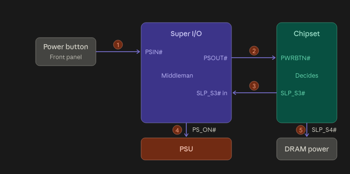
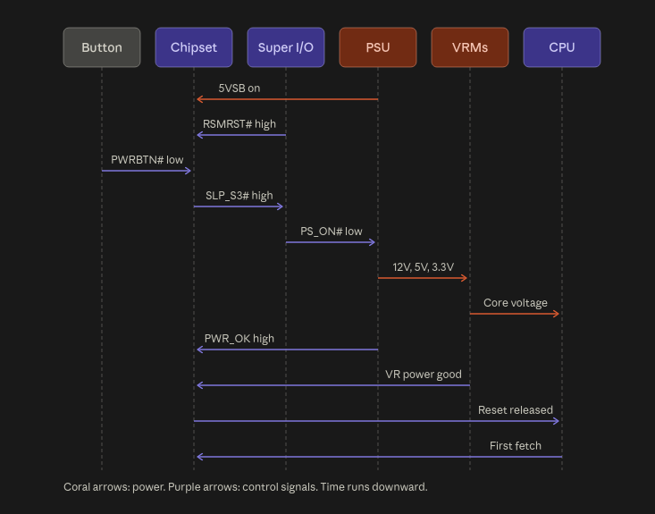

Alright so let's start from the point when you press the power on button on your computer. But hold on, this is not the point where the computer gets the electric power. Your computer never really loses power, it is always having some. Even when you shut it down completely. And even when you pull out the plug on a desktop computer. Without this constant power you get the classic symptom: after unplugging, the clock resets to some year like 2000 or 2016, and some BIOS settings revert.
### Phase 0
#### How and why is this constant power required?
##### The how:
There are multiple ways a PC/Laptop can pull power - the known obvious ones are batteries/power outlets for laptops and power outlets for desktop computers.
But there is one more level under this - coin cell batteries, also called CMOS (Complementary Metal-Oxide-Semiconductor) batteries or CMOS cells.

All motherboards have these coin cell batteries and they last anywhere from 3 to 10 years. The power is drawn from coin cell battery only when the machine loses all power - no power from outlet or battery.
A standard motherboard coin battery (CR2032) delivers a nominal voltage of 3 Volts and a continuous current flow of a few microamps.

##### The why:
Without this battery, your computer would suffer from "amnesia". 

1. BIOS settings:
	1. The motherboard’s firmware (BIOS/UEFI) stores custom hardware configurations that tell the computer how to start up. This battery retains power to the Volatile RAM (CMOS memory) where these settings live. 
	2. Without this power, your custom configurations reset to default. This includes your boot drive order (which disk has Windows/Linux), hardware overclocking, fan curves, and system security passwords.

2. RTC (Real Time Clock):
	1. Your computer does not intuitively know what time it is when turned off. This battery keeps a low-power hardware clock ticking. 
	2. An incorrect system time prevents you from browsing the internet because security certificates (SSL/HTTPS) will flag your connection as insecure and block websites.
	
---

### Phase 1: Plugged in, "OFF", but not dead
Now we know the state of a PC when even the wall plug is in off state. Let's move ahead to what happens when you switch the wall power ON, but don't press the PC's power on button yet.

A lot happens between turning on the plug, and pressing the power button, let's uncover this first.

You switch on the power on the wall plug. Now the AC power from the socket goes to the "PSU (power supply unit)" unit inside your computer - every computer has a PSU, that is what sends the power to the motherboard, CPU, GPU. 

A PSU converts the AC power from the wall outlet to DC power to be used inside the computer, and it also regulates the voltage and protects your PC's internal components.

Assume the [PSU](psu.html) is a black box for now - because it can have its own separate deep dive. In short summary, the [PSU](psu.html) takes in 220V/50Hz or 110V/60Hz of AC power and gives out 2 main output lines (output wires to imagine):

1. A 12V rail (this is the main power supply) 
2. A 5VSB rail (5V stand-by), this is an always-on power supply, which powers on as soon as you press the switch on the wall socket and keeps the essential hardware running on your PC (the clock, circuit which detects the power on button etc.).

Now when you initially turn on the power outlet, only the 5VSB power rail turns on by itself and becomes available. This 5 Volt Stand-by power line turns on some very critical components, out of which the main one for us is:

The [Super IO Chip](super-io-chip.html) - It is a specialized integrated circuit, on a computer's motherboard, which manages various slow, low level, and legacy bandwidth devices. It reports/regulates the lowest level of values like - fan speeds, temperature, voltages. Plus some more. It's called super IO because over time, the functionalities of various smaller low-level circuits were combined to form a single IO chip, hence called the super IO. This is also the circuit which detects the power on button press. This chip runs on 3.3VSB (3.3 Volt standby drawn from the 5V standby rail with small converters).

When the Super IO Chip gets turned on, it holds a signal called *RSMRST#* (spoken as - Resume Reset - Active low, the hash symbol denotes an "active low" signal). It holds RSMRST# in low configuration, means at 0V, until the voltages on standby rails become stable.
###### Slight tangent on active low signals and reset pins.
Active low signal is a digital signal which is configured in such a way that it's considered "ON" (asserted, doing its job) when it’s at a **low voltage (logic 0 / 0 Volts)**, and "OFF" (de-asserted) when it’s high (logic 1, some stable positive Voltage). It’s the opposite of the more intuitive active high convention, where 1 means “do the thing.”
Such configuration is chosen for RESET signal pins, because when a power line is turned on, like a PC receiving power from the PSU via the power outlet, constant high voltage is the natural resting state of this signal pin. And the natural state should be a signal for - "all is good, nothing wrong".

Back to the Super IO Chip holding the `RSMRST# low`. Once the standby rails become stable, the RSMRST# is released by the Super IO Chip, and hence the motherboard receives a `RSMRST# high` signal. And NOW you are ready to press the power button, and it can reach the motherboard to turn on your PC. 
Fun fact: If your 5VSB rail is dead, or if the Super I/O chip is shorted out, the PC will act completely dead and will not turn on at all.

**Okay, now you press the Power Button on your PC, phewww**

This power button you just pressed is also an active-low signal (means a constant high voltage is its natural resting position), when you press it down it is pulled to 0V. The power button press is detected by the Super I/O on a signal pin named `PSIN#` and the Super I/O drives its own output, `PSOUT#` into the chipset’s `PWRBTN#` pin.

>Why is the signal not sent directly to the motherboard chipset?
>_Routing it through a helper chip lets the board add features: blocking the button during certain conditions, powering on from a keyboard key, or handling the “what to do after a power cut” setting._

Now the chipset has a family of different outputs called `SLP_S5#, SLP_S4#, SLP_S3#`, denoting sleep states S5, S4, S3 (because power button can be used to power on a completely shut-down PC, waking from sleep, holding to reset etc.)

For our fresh start case, the chipset releases its sleep signals in a fixed order: `SLP_S5#` goes high, then `SLP_S4#`, then `SLP_S3#`, with small delays between them so each group of rails comes up in sequence. All of these output signals are sent by the chipset and not the super IO chip.
Now, the super IO chip sees the `SLP_S3#` signal go high (output from chipset `SLP_S3#` is connected to the input named `SLP_S3#` on super IO chip), and sends the `PS_ON#` signal to the PSU, by pulling it low to 0V (means, this is also an active-low signal).

An image showing this ping-pong of signals:

FINALLY, THIS STARTS - the main converter on the PSU, the one which sends in the power to the 12V rail.

Interesting detail on how the Super IO signals the PSU.
On one side we have, PSU's circuit which is directly connected to a very high voltage and sometimes unstable power source. And on the other hand we have the delicate motherboard and its chips which needs low, safe, and stable voltages. These two circuits have to be galvanically isolated - which means there should not be ANY wire connection between them whatsoever, none.
We already have the separation on one end, when the 400V is converted to 12V inside the PSU it is internally done via a transformer - which is a galvanically isolating electronic component, because it uses magnetic fields to transfer power.

Now on the other side which we just talked about, how does the super IO signals the PSU to turn on the main 12V line without any wires? ENTER - OPTOCOUPLERS, our second big galvanic isolation tool.
An optocoupler is a switch which can be turned on or off by shining a light on it, it is a component inside the PSU. It has an LED on one side. And a light sensor on the other side. They are separated via a thin plastic sheet. So the LED gets turned on, which shines light on the light sensor and signals the PSU to turn on the big main converter and send power to the main 12V line (again, via transformer).

Now you have the PC motherboard in a state where it has access to 12V constant and reliable power supply.

>Side Note:
>Motherboards have inbuilt [Buck Converter](buck-converter.html) which takes in the 12V DC power supply as input and gives out the required stable voltage as requested for different components - CPU, GPU. Each component with different voltage needs will have its own buck converter.
>Now it's ready to be powered on.

The CPU can’t use the PSU’s rails directly: it needs around 1V at sometimes over 100 amps, delivered very precisely. 
So **VRMs** (voltage regulator modules, a cluster of chokes and capacitors around the CPU socket) convert 12V down to the core voltage. 
They’re switched on in a specific order (memory voltage, chipset-related rails, then core), and each one raises its own power-good signals when stable). The chipset gathers all these “good” signals, starts its clock generators, and waits for its internal clocks to lock onto a stable frequency. [Clock Generators](clock-generators.html) are fundamental electronic circuits that produce a continuous, precise sequence of electrical pulses (a square or sinusoidal wave) to act as the "heartbeat" of a microprocessor and its surrounding system.
The internal clock runs at around 100MHz - using a crystal - this is multiplied inside the CPU to make it run at 2GHz or something like that.

Another image roughly summarizing the above discussion from 5VSB on to First fetch:

Now finally, the time has come to shift into some level of software - the first instruction fetch happens from the SPI flash chip which is soldered onto the motherboard, and contains the UEFI firmware. On a reset the CPU architecture fetches at the exact address `0xFFFFFFF0` from the flash chip, continued...
