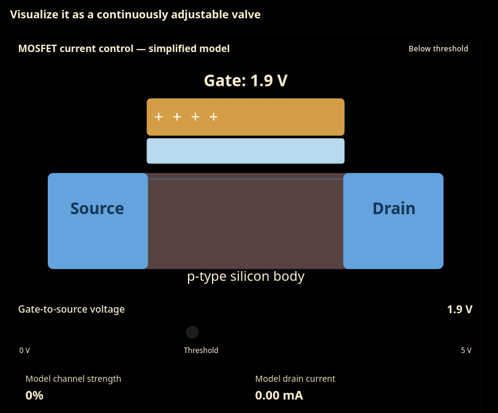
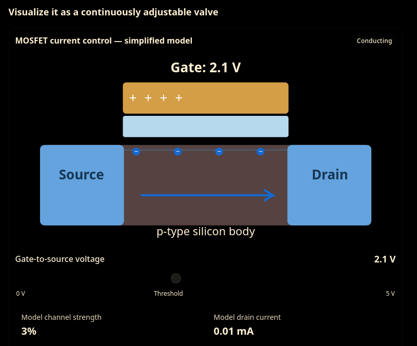
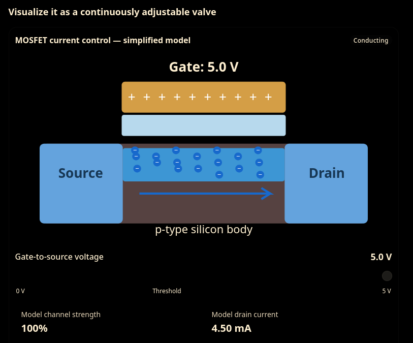

#### Brief Summary
MOSFET - (Metal Oxide semiconductor field effect transistor).
It's much like a light switch that can be turned into an "on" and "off" position but instead of mechanically your finger moving the switch, transistors have the ability to be electrically turned on and off. This binary ability forms the basis for binary logical circuits which is what most of the electronic things are made out of.
##### Mental Model
Imagine it like a box with 3 pins sticking out of it, which can do two things -  not let the electricity pass through, let the electricity pass through. So, it is like a switch. But who turns it on or off? In a switch, our fingers do the work, and it mechanically connects or disconnects two points (pins; called **Source** and **Drain**) to form a conductive path. The finger here is another smaller electric voltage - you apply a small outside voltage to the third pin (called the **Gate**), which magically (magic explained below, in brief, the electric field generated by the small electric voltage on our third pin pulls the electrons in between the two pins which we want to connect/disconnect) forms a conductive path between the two pins to let a current pass through.

Now with this, using an external small voltage, we can control another stream of a larger current and switch it on or off. Moreover, depending on the strength of the outside small voltage (we control the voltage at the third pin for this), we can control the thickness (if we see the conductive path as a wire) of the conductive path, and control the current passing through. 

So, it is not just a switch, it is more like a regulator.
Below images show this. Yellow - Metal gate where external voltage is applied, below it is a thin insulator (light blue).

Image one: Gate Voltage below threshold (OFF)

Image two: Just above the threshold Voltage (ON) but small current

Image three: Increasing the Voltage at gate, increases the current across source and drain

---

One final fascinating point: the gate does not supply the source-to-drain current's energy. That energy comes from the drain-source power circuit. The gate voltage determines how easily the current can flow.
This is why a small control signal can govern a much larger amount of electrical power — and why MOSFETs can function as both analog control devices and digital switches.

---
